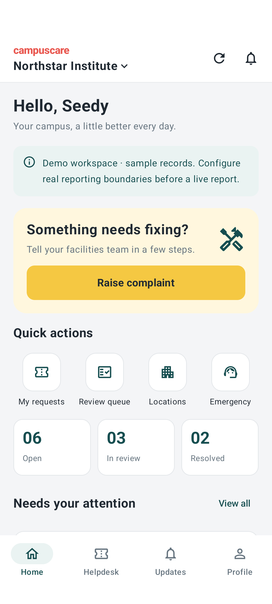
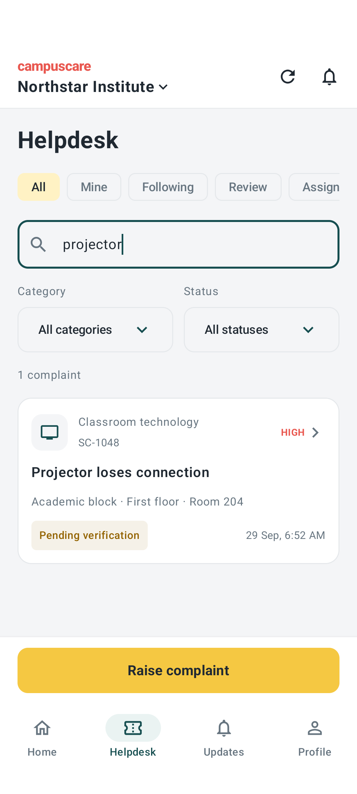

# CampusCare for Android

A native Kotlin / Jetpack Compose client for the existing CampusCare maintenance portal. The interface follows MyGate's familiar community-app patterns: a workspace selector, quick actions, Helpdesk cards, an Updates feed, bottom navigation, and a prominent yellow complaint action. CampusCare uses its own name, icons, colours, and implementation.

<p>
  
  
</p>

Screenshots show fictional local sample data. [Download the Android preview](https://github.com/rohitk987/campuscare/releases/tag/android-preview-0.1).

## Install the preview

Install `CampusCare-Android-preview.apk` on Android 8.0 or later. Open **CampusCare**, then **Sign in to your workspace**. The default server is the existing [CampusCare portal](https://campuscare-facility-hub.sepia-pastime9v.chatgpt.site). The linked 0.1 release is historical and predates the BMSIT OTP policy. Build the current source for the new access handling. Students need an official BMSIT account, a current approved enrollment record and email OTP verification.

This APK is a debug-signed development preview, not a Play Store release. Android may ask you to permit installation from the app used to open the APK.

## Implemented screens and workflows

- Home: organisation switching, quick actions, complaint counts, and recent complaints.
- Helpdesk: search, category/status filters, own complaints, followed issues, review queue, and assigned work.
- New report: native precise-location permission, fresh GPS/network reading, server boundary check, building suggestions, valid floor/area selectors, item details, and duplicate suggestions.
- Evidence: native camera capture intent, image rotation/resizing, EXIF GPS metadata, fresh location associated with the upload, authenticated multipart upload, and evidence-expiry countdown. The interface offers no gallery picker.
- Complaint detail: private photo download, location evidence, chronological history, staff verification, assignment, repair progress, hold/resume, resolution confirmation, comments, and reviewed reopening.
- Updates: reporter notifications, direct complaint links, and mark-all-read.
- Administration: create workspaces, add/edit sites and buildings, add areas, approve/deactivate members, assign site scopes, and update workspace settings.
- Emergency instructions remain accessible without location or camera permission.
- Profile, sign-out, configurable trusted server origin, and activity-recreation state retention.

New reports require location and photo evidence. Authentication, tracking, comments, and reopening requests do not require the reporter to be on site. The server remains authoritative for memberships, scopes, evidence freshness, duplicate submissions, and workflow permissions.

## Authentication and current limits

The sign-in WebView opens CampusCare's **direct BMSIT email and OTP login**. No ChatGPT account is required. Tap **Check sign-in** after verifying the code. Native requests use the shared same-origin session cookies. HTTP 401/428 and explicitly classified enrollment/domain/deactivation denials clear protected state; ordinary workflow permission errors retain the session. Old request responses are discarded after access changes. Sign-out revokes the CampusCare session and clears local state. No identity headers, passwords, bypass tokens, or service credentials are embedded in the app. Cookies are never sent to another origin during redirects; production connections require HTTPS. Previously distributed APKs do not include the updated logout method; rebuild this source for that change.

Historical emulator tests cover local session reuse. **The updated direct email OTP flow has not yet been verified on a physical phone.** The current WebView displays CampusCare's own email/code form and shares its session with native requests. If institutional SSO is added later, validate that provider's supported native sign-in flow separately; the present email OTP login does not use an external identity provider.

The portal login page is shared by link; protected data requires the server-checked BMSIT identity, OTP session, current enrollment or explicitly approved staff role, and active membership. Institutional SSO, platform billing, background push notifications, and Play Store publication are outside this preview. Existing server limitations described in the root README still apply.

GPS accuracy varies indoors and does not identify a floor. The native client rejects location readings flagged as mock, but neither GPS nor a camera intent proves physical presence or a genuine defect. Staff verification is still required.

## Open and build

Open this `android/` directory in Android Studio, or use JDK 17 and Android SDK 35 from the command line. The checked-in Gradle wrapper pins Gradle 8.11.1 with its distribution checksum.

```sh
./gradlew :app:assembleDebug
```

On Windows:

```powershell
.\gradlew.bat :app:assembleDebug
```

The normal output is `app/build/outputs/apk/debug/app-debug.apk`. Set `ANDROID_HOME` to your installed SDK, or use an untracked `local.properties` containing `sdk.dir=...`. Signing keys and machine-specific paths are excluded from source control.

For a machine with limited space, `CAMPUSCARE_BUILD_ROOT` can place module build output on another drive; `GRADLE_USER_HOME` and Gradle's `--project-cache-dir` control the other caches. No machine-specific drive is hardcoded in application source.

## Run against the local backend

Follow the root README to migrate and start the existing web backend at `http://127.0.0.1:5173`. Then:

```sh
adb reverse tcp:5173 tcp:5173
```

In the Android app, open **Connection settings** and use `http://127.0.0.1:5173`. Debug builds also support the emulator host alias `10.0.2.2`. HTTP for arbitrary hosts is rejected. Production builds accept HTTPS only.

The backend's old development identity is rejected by the current BMSIT policy. The historical instrumentation suite uses its tagged backend and synthetic **Android integration checks** workspace; it does not establish current OTP sign-in readiness. The current access-policy unit tests run without a server or mail provider.

## Android verification

For the current BMSIT access handling, run the five unit tests and eight device tests:

```sh
./gradlew :app:testDebugUnitTest :app:connectedDebugAndroidTest -Pandroid.testInstrumentationRunnerArguments.class=com.campuscare.app.NativeAccessTest
```

The device tests start an in-process loopback HTTP fixture. They check OTP expiry, enrollment revocation, ordinary permission errors, identity changes, stale responses and cookies, redirect cancellation, shared cookies and the CampusCare logout endpoint. No mail provider or college account is required; the fixture is absent from the application APK. These tests do not establish hosted WebView sign-in or real OTP delivery.

The following historical workflow tests require their tagged backend; the current BMSIT backend rejects the old development identity. With that local backend and an Android 15 emulator running, use the Windows runner to keep the emulator's synthetic GPS reading fresh throughout the tests:

```powershell
.\scripts\test-local.ps1
```

On other platforms, run `adb reverse tcp:5173 tcp:5173`, send `adb emu geo fix 77.5946 12.9716` once per second in a second terminal, and run `./gradlew :app:connectedDebugAndroidTest`. Stop the coordinate updates when the tests finish. These coordinates belong only to the local test workspace; the runner does not change production boundaries.

The instrumentation suite exercises native login/navigation, tenant and reporting gates, JPEG resizing/geotagging, multipart evidence upload/download, idempotent submission, and repair/reopening transitions. The native report test uses the emulator's location provider and intercepts only the external camera intent to return an explicitly synthetic test photo. Test-only fixtures are compiled into the separate test APK, not the deliverable app.

Physical camera behavior, real campus boundaries/accuracy, provider-specific production sign-in, and multi-account operation still need a pilot on actual devices. See `TESTING.md` for the recorded results and their scope.

## Source layout

| File | Purpose |
| --- | --- |
| `MainActivity.kt`, `Design.kt` | Native app shell, home/helpdesk/updates/profile, visual components |
| `AppState.kt` | Workspace state and available workflow actions |
| `AuthScreen.kt`, `ApiClient.kt` | Portal sign-in, safe connection settings, authenticated requests |
| `ReportScreen.kt`, `DeviceEvidence.kt` | Reporting wizard, Android permissions, camera and geotagging |
| `TicketScreen.kt` | Evidence, timeline, and repair/review actions |
| `ManagementScreen.kt` | Workspaces, facilities, memberships, settings |
| `src/androidTest/` | Local backend and Android UI integration tests |

## Design and platform references

- [MyGate Helpdesk](https://help.mygate.in/articles/124167-how-to-raise-a-helpdesk-ticket-on-mygate-app)
- [MyGate July 2025 dashboard and Helpdesk update](https://mygate.com/wp-content/uploads/2025/11/Society-Dashboard-Updates-July-25_compressed.pdf)
- [Android WebView and authentication guidance](https://developer.android.com/develop/ui/views/layout/webapps)
- [Android command-line builds](https://developer.android.com/build/building-cmdline)
